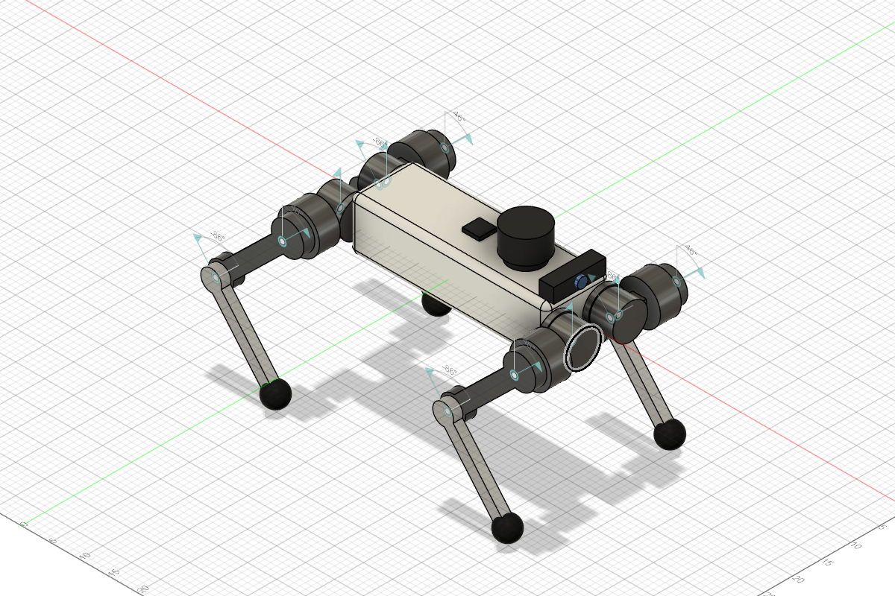

# robot_dog_description

12 自由度四足機器狗，以 Fusion 設計，供 ROS 2 Jazzy 控制（Gazebo Harmonic 或 Isaac Sim 模擬）
與強化學習使用。配備 IMU、2D LiDAR、RGB 相機。



## 規格

| 項目 | 數值 |
|---|---|
| 機身 (base_link) | 340 × 110 × 90 mm，圓角 10 mm |
| 髖關節位置 | x = ±0.20 m、y = ±0.04 m |
| 大腿 / 小腿長 | 0.16 m / 0.16 m，足端球 r = 0.02 m |
| 足端橫向位置 | y = ±0.14 m |
| 站姿高度 | 約 0.26 m（thigh 0.8、calf −1.5 rad） |
| 總質量 | 8.83 kg（base 4.13、hip 0.71×4、thigh 0.37×4、calf 0.10×4） |

座標慣例 REP-103：X 前、Y 左、Z 上，base_link 原點在機身中心。
URDF 零位 = 四腳垂直伸直（Fusion 模型的原始姿態）。

| 關節 | 軸 | 範圍 (rad) | 正方向 |
|---|---|---|---|
| `{FL,FR,RL,RR}_hip_joint` | +X | −0.80 ~ 0.80 | 左腿向外、右腿向內 |
| `{leg}_thigh_joint` | +Y | −1.57 ~ 3.49 | 膝蓋往後擺 |
| `{leg}_calf_joint` | +Y | −2.70 ~ 0.00 | 負值為屈膝 |

| 感測器 | frame | 位置 (base_link, m) | 話題 |
|---|---|---|---|
| IMU | `imu_link` | (0, 0, 0.048) | `/imu`、`/imu_sensor_broadcaster/imu` |
| LiDAR | `laser_link` | (0.080, 0, 0.085) | `/scan` |
| 相機 | `camera_link` / `camera_optical_link` | (0.178, 0, 0.0575) | `/camera/image_raw`、`/camera/camera_info` |

## 「固定在 base_link 上的零件都算 base_link」

- Fusion 中 `base_link` 元件同時包含機身、4 個髖馬達座、IMU、LiDAR、相機這些實體，
  所以匯出後只有一個 base_link（質量與慣量已包含感測器）。足端球同理屬於 calf。
- ROS 版 URDF 另外有 `imu_link`、`laser_link`、`camera_link`、`camera_optical_link`、`{leg}_foot`：
  這些是**無質量、無幾何**的座標框架，只用來當 `frame_id`；Gazebo 會自動把它們併入父連桿。
- 強化學習版 `urdf/robot_dog_rl.urdf` 只有 13 個實體連桿，沒有任何固定關節。

## 檔案結構

```
robot_dog_description/
├── urdf/
│   ├── robot_dog.urdf.xacro          # 入口：sim_mode:=none|gazebo|isaac
│   ├── robot_dog_core.xacro          # 連桿/關節（由 tools/generate_description.py 產生）
│   ├── robot_dog.ros2_control.xacro  # 12 關節 + IMU；依 sim_mode 換 hardware 外掛
│   ├── robot_dog.gazebo.xacro        # gz_ros2_control 外掛、IMU/LiDAR/相機、足端摩擦
│   └── robot_dog_rl.urdf             # 強化學習用（產生）
├── meshes/                           # 連桿座標系、單位公尺的 STL（產生）
├── config/  ros2_controllers.yaml, gz_bridge.yaml, rl_defaults.yaml
├── launch/  display.launch.py, gazebo.launch.py, isaac.launch.py
├── isaac/
│   ├── robot_dog_isaac.py            # Isaac Sim 端（ros2_control 模式）：組裝下面的模組
│   ├── robot_dog_sim/                # 共用模組：robot_spec（常數）、kit、world、robot（URDF 匯入）、
│   │                                 #   sensors（IMU/相機/RTX LiDAR）、ros_graph（OmniGraph ROS 2）、util、policy_meta
│   ├── tools/rclpy_probe.py          # 確認 rclpy 能和 OmniGraph ROS 2 橋接在同一程序共存
│   └── tests/                        # pytest（純 Python 部分，系統 python3 即可）
├── worlds/empty.sdf                  # 已載入 Sensors / Imu 系統
├── scripts/stand_up.py               # 平滑站立示範
├── rviz/robot_dog.rviz
├── fusion/
│   ├── scripts/RobotDog12DOF/        # Fusion 建模腳本（參數在檔案最上方）
│   ├── scripts/RobotDog12DOF_Export/ # Fusion 匯出腳本
│   ├── robot_dog_fusion.json         # Fusion 算出的質量、質心、慣量、關節
│   └── meshes_raw/                   # Fusion 原始 STL（世界座標、mm）
├── isaaclab/robot_dog_lab/           # Isaac Lab 3.0 專案用的檔案（資產設定 + 平地速度追蹤任務）
└── tools/
    ├── generate_description.py       # fusion/ → meshes/ + urdf（只用標準函式庫）
    └── mujoco_stand_test.py          # MuJoCo 物理站立測試
```

## Fusion 工作流程

兩個腳本已安裝在 Fusion 的 *Utilities > Scripts and Add-Ins*：

1. **RobotDog12DOF**：產生新的設計。要改尺寸、關節範圍、材質，修改 `RobotDog12DOF.py`
   最上方的常數後重新執行。
2. **RobotDog12DOF_Export**：選擇本套件的 `fusion/` 資料夾，匯出 STL 與 `robot_dog_fusion.json`。
   匯出前所有關節必須回到 0（腳本會檢查）。
3. 重新產生 URDF 與網格：
   ```bash
   python tools/generate_description.py
   ```

設計也相容你原本的 `Fusion_URDF_Exporter_ROS2`（已驗證可讀出 12 關節、13 連桿），
但它的連桿名稱會變成 `FL_hip_1`，碰撞用網格，effort/velocity 固定為 100，
所以建議用上面的流程。

## ROS 2 Jazzy（在另一台 Ubuntu 24.04 上執行）

Windows 只用來跑 Fusion；整個 `robot_dog_description` 資料夾（或 `robot_dog_description.zip`）
複製到 Ubuntu 就能用，URDF、網格都已經在裡面，不需要 Fusion。

```bash
mkdir -p ~/ros2_ws/src && cd ~/ros2_ws/src
unzip ~/Downloads/robot_dog_description.zip      # 或 cp -r 整個資料夾
cd ~/ros2_ws
rosdep install --from-paths src --ignore-src -y
colcon build --packages-select robot_dog_description
source install/setup.bash
```

之後在 Fusion 改了設計：在 Windows 重新匯出並執行 `tools/generate_description.py`，
再把更新後的 `meshes/` 與 `urdf/` 複製過去重新 `colcon build`。

RViz（關節滑桿，預設站姿）：
```bash
ros2 launch robot_dog_description display.launch.py
```

Gazebo Harmonic 模擬（加 `rviz:=true` 一起開 RViz）：
```bash
ros2 launch robot_dog_description gazebo.launch.py
```

另一個終端讓它站起來：
```bash
ros2 run robot_dog_description stand_up.py --ros-args -p use_sim_time:=true
```

控制器：

| 控制器 | 狀態 | 指令話題 |
|---|---|---|
| `joint_state_broadcaster` | active | 發佈 `/joint_states` |
| `imu_sensor_broadcaster` | active | 發佈 `/imu_sensor_broadcaster/imu` |
| `joint_group_position_controller` | active | `/joint_group_position_controller/commands`（12 個角度） |
| `joint_group_effort_controller` | inactive | `/joint_group_effort_controller/commands`（12 個力矩） |

RL 策略輸出力矩（自己做 PD）時切換：
```bash
ros2 control switch_controllers --activate joint_group_effort_controller --deactivate joint_group_position_controller
```

關節順序（所有控制器、`rl_defaults.yaml` 一致）：
`FL_hip, FL_thigh, FL_calf, FR_hip, FR_thigh, FR_calf, RL_hip, RL_thigh, RL_calf, RR_hip, RR_thigh, RR_calf`

## Isaac Sim 6.2（ROS 2 控制）

ros2_control 在 Isaac Sim 模式（`sim_mode:=isaac`）使用 ros2_control 官方的
`joint_state_topic_hardware_interface/JointStateTopicSystem`：
Isaac Sim 發佈 `/isaac_joint_states`、訂閱 `/isaac_joint_commands`（都是 `sensor_msgs/JointState`），
控制器、關節順序、`stand_up.py` 都和 Gazebo 一樣。

| | Gazebo | Isaac Sim |
|---|---|---|
| 位置指令 | gz_ros2_control（速度追位置） | PhysX 關節 PD 驅動（kp 20、kd 0.5） |
| 力矩指令 | 同時可用，切換控制器 | 啟動時選 `--effort` / `command:=effort` |
| IMU | ros2_control + `/imu` | `/imu`（Isaac 直接發佈） |
| LiDAR | `/scan` | `/scan`（RTX `Example_Rotary_2D`；沒有此設定時改發 `/scan/points`） |
| 相機 | `/camera/image_raw` | `/camera/image_raw` |

需要的 ROS 套件（Isaac 模式的 hardware interface）：
```bash
sudo apt install -y ros-jazzy-joint-state-topic-hardware-interface
```

1. Isaac Sim 6.2 用 `~/IsaacLab` uv 環境裡的 pip 版，先 source ROS 2 再啟動（沒 source 會直接結束並提示）：
   ```bash
   source /opt/ros/jazzy/setup.bash
   cd ~/IsaacLab && export OMNI_KIT_ACCEPT_EULA=yes
   uv run --extra isaacsim python ~/dog_12dof_ws/robot_dog_description/isaac/robot_dog_isaac.py
   ```
   終端會逐項列出 `joint states / IMU / camera / LiDAR ... ok`。
   加 `--headless` 不開視窗；加 `--max-frames 600` 跑 600 幀後自動結束（exit 0 = 正常），可當 smoke test。
   程式出錯時會印出 traceback 並以 exit 1 結束。
2. 另一個終端：
   ```bash
   cd ~/dog_12dof_ws && source install/setup.bash
   ros2 launch robot_dog_description isaac.launch.py
   ros2 run robot_dog_description stand_up.py --ros-args -p use_sim_time:=true
   ```
   kp 20 承重下會下沉：站穩後 thigh 約 0.76～0.79、calf 約 −1.61～−1.66 rad（目標 0.8 / −1.5）。
   筆電上同時跑 RTX LiDAR 和相機，模擬大約是即時的 0.75 倍，所以 `ros2 topic hz /scan` 看到的是約 7.5 Hz（sim time 10 Hz）。
3. 力矩控制（RL 策略自己做 PD）：
   `robot_dog_isaac.py --effort` 搭配 `isaac.launch.py command:=effort`，
   指令送到 `/joint_group_effort_controller/commands`。

注意：
- 腳本依 Isaac Sim 6.x API 撰寫：URDF 用 `URDFImporter` 轉成 USD（6.0 起已移除
  `URDFParseAndImportFile`）、LiDAR 用 `isaacsim.sensors.experimental.rtx`、
  ROS 2 節點來自 `isaacsim.ros2.nodes`。匯入後的連桿在 `Geometry/`、關節在 `Physics/` 之下，
  腳本以名稱搜尋，所以不受階層影響。
- Isaac Sim importer 把關節、articulation、質量放在 `Physics` variant set 裡，而且預設不選，
  所以腳本載入時會選 `physics`（和 Isaac Lab 轉檔的預設相同），否則會找不到任何關節。
- 感測器各自獨立，若某項顯示 `FAILED`，其他功能照常，可在 GUI 手動補上該感測器
  （掛在 `base_link` 下，位置見上面的感測器表）。
- 也可以用 Isaac Lab 轉好的 USD：
  `uv run --extra importers isaaclab -p scripts/tools/convert_urdf.py urdf/robot_dog_rl.urdf <輸出資料夾>`，
  再用 `robot_dog_isaac.py --usd <輸出資料夾>/robot_dog/robot_dog.usda` 載入。
- Isaac Sim 和 ROS 2 跑在不同電腦也可以，兩邊設定相同的 `ROS_DOMAIN_ID` 並在同一網段即可，
  但放同一台最省事。

## 強化學習

- `urdf/robot_dog_rl.urdf`：13 個連桿、基本形狀碰撞（盒、圓柱、足端球）、
  網格只做視覺、相對路徑 `../meshes`、關節阻尼 0（力矩控制不會被匯入的驅動額外阻尼），
  不含任何模擬器專用標籤，可直接給 Isaac Lab、MuJoCo、PyBullet。
- `config/rl_defaults.yaml`：預設站姿、PD 增益、action scale、足端連桿名稱。
- 足端接觸：足端球是 `{leg}_calf` 的碰撞體，接觸感測用 `.*_calf`。

### Isaac Lab 3.0：平地速度追蹤任務 `RobotDog-Velocity-Flat`

`isaaclab/robot_dog_lab/` 是任務本身，`isaaclab/scripts/*.py` 直接 import 它，
在 `~/IsaacLab` 的 uv 環境執行（不另建 Isaac Lab 外部專案，以免再裝一份 Isaac Sim）。
詳細步驟見 [isaaclab/README.md](isaaclab/README.md)。

| 檔案 | 內容 |
|---|---|
| `assets/robot_dog.py` | `ROBOT_DOG_CFG`：`UrdfFileCfg` 直接讀 URDF（第一次自動轉 USD）、DC 馬達模型 25 N·m / 30 rad/s、kp 20 / kd 0.5、站姿出生 0.32 m |
| `tasks/locomotion/velocity/flat_env_cfg.py` | 繼承 Isaac Lab 的 `LocomotionVelocityRoughEnvCfg`，改成平地，身體名稱換成 `base_link` / `.*_calf` / `.*_thigh` |
| `tasks/locomotion/velocity/agents/rsl_rl_ppo_cfg.py` | RSL-RL PPO，128×3 MLP，1000 iterations |
| `data/robot_dog/` | RL URDF + 網格的副本（`generate_description.py` 會自動同步） |

依 3.0 的寫法：四元數是 XYZW（這裡用預設的單位四元數，沒有另外指定）、
致動器欄位是 `actuator_effort_limit` / `actuator_velocity_limit`、
物理後端預設 `isaacsim_physx`，也可用 `physics=newton_mjwarp`。

```bash
cd ~/IsaacLab && export OMNI_KIT_ACCEPT_EULA=yes PYTHONUNBUFFERED=1
uv run --extra isaacsim python ~/dog_12dof_ws/robot_dog_description/isaaclab/scripts/train.py --task RobotDog-Velocity-Flat --run_name v1
```

和 Isaac Lab 預設的速度追蹤任務相比，為了配合 Nav2 改了：`heading_command=False`（wz 直接取樣）、
零指令環境 10%、速度追蹤獎勵 `std` 0.25（低速也追得準）。

目前只做平地任務。崎嶇地形需要高度掃描器掛在 `base_link` 上，
而 Isaac Sim 6 匯入後的連桿位在 `Geometry/` 之下，路徑要先在你的環境確認，所以先不放。

MuJoCo 物理檢查（`pip install mujoco`）：
```bash
python tools/mujoco_stand_test.py
```
目前結果：4 秒後四足著地、roll 0°、pitch −1.2°、機身高 0.226 m
（kp=20 的 PD 在承重下約下沉 0.145 rad，屬正常；要更挺可提高 kp）。

## 需要換成實際數值的地方

- **質量**：目前依材質估算（機身 ABS、髖與大腿鋁、小腿 ABS、足端橡膠）。
  換成真實馬達、電池重量：在 Fusion 改材質或實體後重新匯出。
- **馬達**：effort 25 N·m、velocity 30 rad/s 是佔位值，改
  `tools/generate_description.py` 的 `EFFORT`/`VELOCITY`、
  `robot_dog.ros2_control.xacro` 的 `max_effort`、`rl_defaults.yaml`。
- **實機**：把 `robot_dog.ros2_control.xacro` 中的 `mock_components/GenericSystem`
  換成你的馬達驅動 hardware interface。

## 驗證狀態

已在 Windows 上驗證：xacro 各模式（none / gazebo / isaac position / isaac effort）展開、
URDF 樹與慣量檢查、MuJoCo 站立測試、與 Fusion_URDF_Exporter_ROS2 的相容性。
Isaac Sim 6.2 / Isaac Lab 3.0 的檔案依官方文件與 Isaac Lab v3.0.0 原始碼（Go1/Go2 設定）撰寫。
尚未實際執行：`colcon build`、RViz、Gazebo、Isaac Sim、Isaac Lab 訓練
（這台電腦沒有 ROS 2、Isaac Sim、Isaac Lab），第一次執行時請留意終端訊息。
