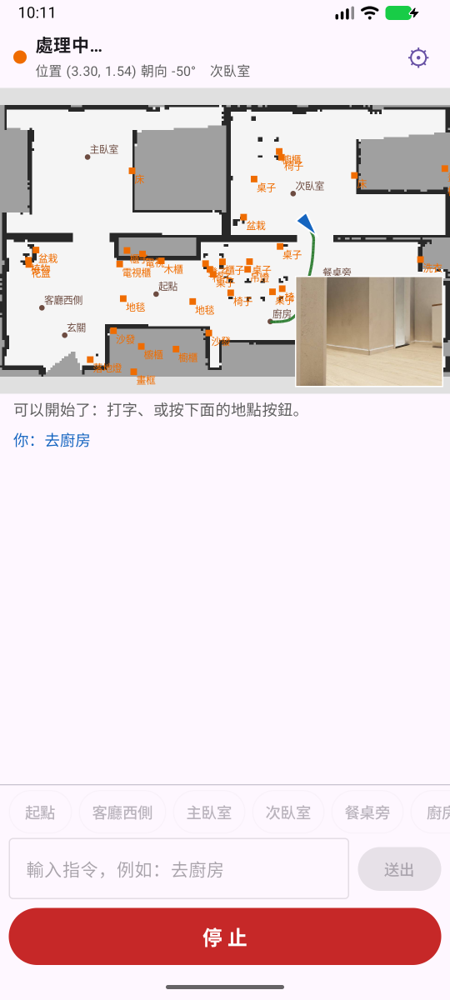

# robot_dog_phone

在家裡拿 Android 手機叫機器狗。app 只是遙控畫面：狗、Nav2、Gemini、物件記憶都在電腦上，由
`ros2 run robot_dog_agent phone` 提供（見 [robot_dog_agent/README.md](../robot_dog_agent/README.md) 的「手機版」）。
手機和電腦要在同一個 Wi-Fi。



## 畫面

- **狀態列**：圓點（綠＝待命、橘＝處理中、紅＝連不上或啟動失敗）、狀態文字、位置和區域；⚙ 回設定頁。
- **大畫面**：預設是地圖，右下角小窗是相機，點小窗互換。
  - 地圖上有牆、地點（棕色圓點）、記住的物件（橘色方塊）、Nav2 的路線（綠線）、目標（紅色 ✕）、狗（藍色三角形）。
  - 待命時點地圖一下，會先放一個灰色 ✕，下面出現「去這裡 (x, y)　[去][取消]」，按「去」狗才出發。
- **對話**：`你：`、`狗：`、工具紀錄、`[錯誤]`，和電腦視窗相同。
- **地點按鈕**（可左右滑，最後一顆是「巡邏」）、輸入框、紅色停止鈕。

app 在前景時螢幕不會關；退到背景就停止連線，回來再自動接上。

## 第一次連線

1. 電腦執行 `ros2 run robot_dog_agent phone`，記下終端機印的位址和配對碼。
2. 電腦的防火牆要開放 8765 port（只要做一次，自己執行）：

   ```bash
   sudo ufw allow from 192.168.0.0/24 to any port 8765 proto tcp
   ```
3. 打開 app。Android 17 以上會問「附近的裝置／區域網路」權限，要按允許。
4. 在設定頁填位址（例如 `192.168.0.154:8765`）和 6 位數配對碼，按「連線」。錯誤訊息分成三種：
   連不上電腦（位址錯、電腦沒開 `phone`、防火牆）、這個位址不是機器狗的伺服器、配對碼錯誤。

## 建置和安裝

需要 Android Studio（或 Android SDK）和 JDK 17 以上。專案用 Gradle wrapper，第一次建置會下載 Gradle 和函式庫。

用 Android Studio：File > Open 選 `robot_dog_phone/`，接上手機（開啟 USB 偵錯）後按 Run。

用終端機：

```bash
cd ~/dog_12dof_ws/robot_dog_phone
./gradlew assembleDebug
~/Android/Sdk/platform-tools/adb install -r app/build/outputs/apk/debug/app-debug.apk
```

要用 Android 模擬器測，位址填 `10.0.2.2:8765`（模擬器裡指向電腦本機，不受防火牆影響）。

## 測試

```bash
cd ~/dog_12dof_ws/robot_dog_phone && ./gradlew test
```

JVM 單元測試，不需要手機：解析伺服器回應（樣本在 `app/src/test/resources/api/`，由 `robot_dog_agent` 的
`test_phone_server.py` 從真的伺服器產生，兩邊用同一份）、地圖座標換算、MJPEG 切張、對話紀錄、API 客戶端。

## 檔案

| 檔案（`app/src/main/java/com/robotdog/phone/`） | 內容 |
|---|---|
| `Model.kt` | 伺服器回應的資料型別和 JSON 解析 |
| `MapGeometry.kt` | 地圖座標和畫面像素互換（和 `map_view.MapView` 相同） |
| `Mjpeg.kt` | 從相機串流切出一張張 JPEG |
| `ChatLog.kt` | 對話紀錄：加前綴，伺服器重開時從頭來 |
| `Api.kt` | 每個伺服器介面一個函式、錯誤分類 |
| `Settings.kt` | 電腦位址和配對碼 |
| `RobotViewModel.kt` | 每 0.2 秒拿狀態、長輪詢對話、相機、斷線重試 |
| `MainActivity.kt`、`MainScreen.kt`、`MapCanvas.kt`、`SettingsScreen.kt` | 畫面 |

伺服器的介面見設計文件 [2026-11-19-phone-app-design.md](../docs/superpowers/specs/2026-11-19-phone-app-design.md) 第 4 節。
